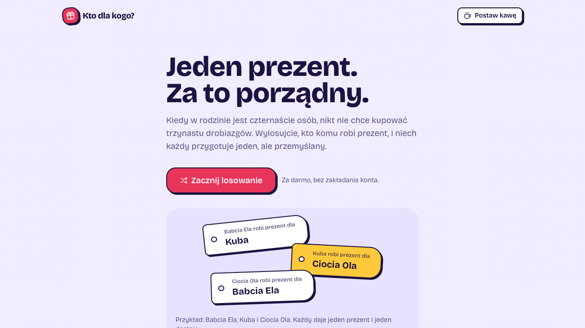

# Kto dla kogo?

A gift exchange draw for family and friends: each participant gives a gift to **exactly one** other person.
Instead of 13 small gifts in a family of 14 — one thoughtful present.

https://kto-dla-kogo.vercel.app

## Features

- an occasion with a name, budget, and gift-giving date,
- 3–30 participants (any number, including odd numbers), unique names,
- pair exclusions (e.g. spouses won't be assigned to each other),
- a private link for each person — shareable via SMS, WhatsApp, or by copying; the result is encoded in `/wynik#…`, with no backend required.

## Algorithm

[`lib/draw.ts`](lib/draw.ts): first, a Fisher–Yates shuffle with rejection sampling (uniform distribution),
and when exclusions are highly restrictive — randomized bipartite matching (Kuhn's algorithm).
If no valid assignment exists, it returns `{ ok: false, reason: 'impossible' }`.

## Structure

```text
app/                 routes: / (home), /losowanie (wizard), /wynik (result reveal), /dotacja
features/draw/       wizard: steps, state (Context + useReducer + localStorage)
features/reveal/     result reveal page
lib/                 pure logic: draw, share, phone, storage, format
model/               zod schemas
components/          shared: header, footer, coffee, regulations, ui (shadcn)
```

## Getting Started

```bash
npm install
npm run dev
npm test
npm run lint
npm run build
```
